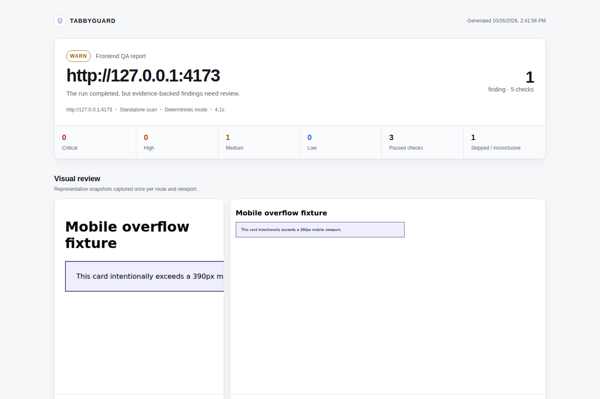

<div align="center">

# TabbyGuard

**Catch reproducible frontend problems before your users do.**

Run targeted browser QA against a deployed website. Get a clear GitHub Actions summary, actionable findings, and an HTML visual report backed by screenshots, logs, accessibility results, and Playwright traces.

**No evidence, no finding.** Works as a [GitHub Action](#try-it-in-github-actions) or an [npm CLI](#run-it-locally-with-npm). AI is optional.

[GitHub Marketplace](https://github.com/marketplace/actions/tabbyguard) · [npm](https://www.npmjs.com/package/tabbyguard) · [Configuration](#inputs) · [Testing](docs/testing.md)

</div>

---

## See what you get



_Actual TabbyGuard report from the repository's intentionally broken demo fixture. No mock dashboard or stock imagery._

| Your question                           | TabbyGuard shows you                                                   |
| --------------------------------------- | ---------------------------------------------------------------------- |
| Did the browser encounter a real issue? | Reproducible findings, check statuses, and severity counts             |
| What happened on mobile and desktop?    | Viewport-size visual snapshots and failure screenshots                 |
| Where can I debug it?                   | Browser logs, Axe JSON, and Playwright traces                          |
| How do I share the result?              | A downloadable GitHub Actions artifact with `report.html` and evidence |

**Checks include:** runtime exceptions, first-party network failures, automated accessibility violations, horizontal overflow, keyboard focus progression, and safe interaction probes. Checks that cannot be safely completed are recorded as skipped or inconclusive rather than invented defects.

## Try it in GitHub Actions

Add `.github/workflows/frontend-qa.yml` to your repository:

```yaml
name: Frontend QA

on:
  workflow_dispatch:
    inputs:
      preview_url:
        description: "Publicly reachable URL to test (https://...)"
        required: true
        type: string

permissions:
  contents: read

jobs:
  browser-qa:
    runs-on: ubuntu-latest
    steps:
      - name: Run TabbyGuard
        id: tabbyguard
        uses: tabitha-dev/TabbyGuard@v3
        with:
          preview-url: ${{ inputs.preview_url }}
          routes: /
          screenshot-mode: all
          fail-on-severity: high
```

Then open **Actions → Frontend QA → Run workflow**, enter the URL of your deployed site, and run it. No API key or GitHub token input is required for this standalone workflow.

**Where are the results?** Open the workflow run to see the QA summary and download its **tabbyguard-evidence** artifact. Unzip the artifact and open `report.html` for the visual review. The artifact also contains JSON and supporting evidence.

### Add pull-request reviews

Want automatic PR comments with screenshot and trace evidence? Follow the [copy-ready PR workflow](docs/pr-workflow.md). It includes a working example, the required preview URL setup, and the GitHub permissions. Deploy your preview **before** TabbyGuard runs.

TabbyGuard summarizes findings in the PR and links its evidence artifact. On forked PRs, GitHub may restrict comment permissions; evidence and the Actions summary remain available.

## Run it locally with npm

With Node.js 20+ and Chrome/Chromium installed:

```bash
npx --yes tabbyguard@3.1.1 https://example.com --screenshot-mode all --open
```

Replace `https://example.com` with your website URL. TabbyGuard creates `.tabbyguard/report.html`, `run_summary.json`, viewport snapshots, logs, accessibility files, and traces. `--open` opens the report where supported.

**Windows PowerShell:** if script execution is restricted, run `npx.cmd` instead of `npx`.

**Interpret the outcome:** `PASS` means no evidence-backed findings were found **in the checks performed**. `WARN` reports findings below the configured failure threshold; `FAIL` means the threshold was met. TabbyGuard is targeted browser QA, not a substitute for full accessibility auditing or end-to-end coverage.

---

## The visual report

`report.html` is generated from the same deterministic evidence used to decide findings. It has no CDN or external runtime dependency.

The report includes:

- Overall `PASS`, `WARN`, or `FAIL` outcome
- Tested URL, mode, duration, commit/PR context when available
- Critical / high / medium / low counters
- Representative **mobile and desktop viewport snapshots** captured once per route and viewport
- Filterable finding cards
- Route, viewport, category, severity, and confidence
- Likely cause and related changed files
- Screenshot, browser log, Axe JSON, and Playwright trace links
- Full check-coverage table showing **passed / failed / skipped / inconclusive** work
- Light and dark presentation based on the viewer's system preference

The UI is intentionally restrained: neutral surfaces, compact typography, meaningful severity color, and no decorative AI-style dashboard elements.

---

## What TabbyGuard checks

### Runtime

- Uncaught browser exceptions
- Console errors emitted while a target route is loaded or exercised

### Network

- Failed **first-party** requests
- First-party 5xx responses
- Third-party analytics, ads, fonts, and telemetry are not promoted to findings

### Accessibility

- Axe WCAG automated scans
- Serious and critical automated violations
- Accessible-name, semantics, contrast, and related Axe-detectable problems

### Responsive layout

- Mobile, tablet, and desktop viewports when selected by the plan
- Horizontal document overflow
- Visible elements extending beyond the viewport

### Interaction

- Navigation/menu triggers
- Dialog open and Escape behavior
- Safe form focus probes

If a safe target cannot be identified, the check is **skipped** rather than turned into a defect.

### Keyboard

- Visible focusable-element count
- Tab focus progression
- Repeated focus that indicates keyboard navigation is not advancing

---

## Visual evidence

With the default:

```yaml
screenshot-mode: all
```

TabbyGuard captures one representative **visible viewport** snapshot per route/viewport and additional viewport screenshots for failed checks. Captures temporarily request reduced motion and disable animations so scroll-revealed content is visible, without leaving the rest of the test in reduced-motion mode. This avoids very tall, blank, or repeated full-page screenshots, and keeps the image dimensions tied to the selected browser viewport. Click a preview to inspect the native-size PNG.

Other modes:

```text
all       representative viewport snapshots + failure screenshots
failures  failure screenshots only
none      no PNG screenshots
```

Playwright traces and raw browser logs remain available regardless of screenshot mode.

### Page reuse and isolation

For performance, **layout, runtime, and network** checks aimed at the same route and viewport share a single navigation, even when checks are not next to each other in the plan. They share one complete Playwright trace, while retaining individual logs and failure screenshots. Navigation errors and HTTP status are retained for each affected check.

**Accessibility (Axe), keyboard, and interaction** probes continue in fresh contexts. This avoids leaking injected scripts, keyboard focus, or user interaction state between checks. The output remains in the original planned check order. Runtime gains depend on the number of repeated passive checks; routes with only one check are unaffected.

---

## Check states

| Status         | Meaning                                        | Creates a finding? |
| -------------- | ---------------------------------------------- | -----------------: |
| `passed`       | The targeted behavior was evaluated and worked |                 No |
| `failed`       | Concrete browser evidence reproduced a defect  |            **Yes** |
| `skipped`      | No safe/relevant target could be identified    |                 No |
| `inconclusive` | There was not enough evidence either way       |                 No |

A missing menu, dialog, or form target is not a product failure by itself.

---

## Findings and confidence

TabbyGuard does not use decorative confidence percentages.

Every finding includes a confidence level plus explicit reasons, for example:

```text
Confidence: high

- Browser check reproduced a concrete layout signal.
- Document width exceeded the viewport width.
- Screenshot and raw browser evidence were captured.
```

AI-assisted mode cannot invent findings, remove deterministic findings, or change their severity/confidence.

---

## Deterministic and assisted modes

### Deterministic — default

```yaml
mode: deterministic
```

No model key is required. Changed files and added diff lines select risk rules using whole filename tokens (including CamelCase), reducing accidental matches. The planner first covers distinct requested routes, then different risk categories, then fills the remaining `max-checks` budget. A budget smaller than the number of requested routes cannot cover every route. Browser evidence decides the result.

### Assisted — optional

```yaml
mode: assisted
openai-api-key: ${{ secrets.OPENAI_API_KEY }}
```

Assisted mode can refine planning and improve suggested technical causes. Browser evidence remains authoritative.

---

## Inputs

| Input              | Required | Default         | Description                                       |
| ------------------ | -------: | --------------- | ------------------------------------------------- |
| `github-token`     |      Yes | —               | Reads PR metadata and optionally posts the review |
| `preview-url`      |      Yes | —               | Preview deployment URL                            |
| `mode`             |       No | `deterministic` | `deterministic` or `assisted`                     |
| `fail-on-severity` |       No | `high`          | `none`, `critical`, `high`, `medium`, `low`       |
| `routes`           |       No | `/`             | Comma-separated approved routes                   |
| `openai-api-key`   |       No | —               | Used only in assisted mode                        |
| `openai-model`     |       No | `gpt-5.6-terra` | Model used in assisted mode                       |
| `artifact-dir`     |       No | `.tabbyguard`   | Visual report/evidence directory                  |
| `upload-artifacts` |       No | `true`          | Upload report/evidence to the workflow            |
| `browser-channel`  |       No | `chrome`        | Installed browser channel                         |
| `max-checks`       |       No | `16`            | Maximum targeted checks, 1–24                     |
| `post-comment`     |       No | `true`          | Post/update the PR review                         |
| `screenshot-mode`  |       No | `all`           | `all`, `failures`, or `none`                      |

## Outputs

| Output           | Meaning                                                     |
| ---------------- | ----------------------------------------------------------- |
| `result`         | `pass`, `warn`, or `fail`                                   |
| `findings-count` | Total evidence-backed findings                              |
| `critical-count` | Critical findings                                           |
| `high-count`     | High findings                                               |
| `medium-count`   | Medium findings                                             |
| `low-count`      | Low findings                                                |
| `run-summary`    | Path to `run_summary.json`                                  |
| `report-path`    | Path to `report.html`                                       |
| `evidence-path`  | Artifact/evidence directory                                 |
| `artifact-id`    | GitHub artifact ID when uploaded                            |
| `artifact-url`   | Direct GitHub URL for the uploaded report/evidence artifact |

---

## GitHub-native reporting

TabbyGuard deliberately distinguishes **workflow success** from **QA findings**.

For example, `fail-on-severity: none` can leave the workflow green while the summary still clearly displays `WARN` and finding counts. Findings are also emitted as GitHub annotations so they are visible without opening raw logs.

When artifact upload succeeds, both the workflow summary and PR comment link directly to the visual report/evidence artifact.

---

## Standalone planning

When there is no pull request, TabbyGuard uses a bounded smoke plan per requested route:

- Mobile layout
- Mobile accessibility
- Desktop runtime
- Desktop first-party network
- Desktop keyboard progression

In GitHub PR mode, changed files and bounded diff context drive the targeted risk mapper. The plan now distributes checks across changed surfaces and all requested routes instead of spending the budget on the first matching rule or route.

---

## Security and privacy

- Deterministic mode sends no pull-request content to a model provider.
- Evidence remains inside the configured local directory / GitHub Actions artifact.
- The HTML report escapes website-controlled text before rendering it.
- The report is self-contained and uses a restrictive Content Security Policy.
- Third-party actions in this repository's own workflows are pinned to immutable commit SHAs.
- Fork PR comment failures are non-fatal; the Actions summary and artifact remain available.

See [`SECURITY.md`](./SECURITY.md) for more detail.

---

## Architecture

```text
                 ┌─────────────────────┐
                 │   TabbyGuard Core   │
                 └─────────┬───────────┘
                           │
              ┌────────────┴────────────┐
              │                         │
      GitHub Action entry          Standalone CLI
              │                         │
      PR change context             URL + routes
              └────────────┬────────────┘
                           │
                  risk / smoke plan
                           │
                  real browser checks
                           │
     passed / failed / skipped / inconclusive
                           │
               deterministic findings
                           │
        ┌──────────────────┼──────────────────┐
        │                  │                  │
  report.html       run_summary.json    raw evidence
        │
  GitHub summary + PR review + artifact link
```

See [`docs/architecture.md`](./docs/architecture.md) for implementation notes.

---

## Testing

The repository includes controlled fixtures for:

- clean layout
- mobile overflow
- accessibility regression
- runtime exception
- dialog Escape regression
- keyboard focus regression

Unit tests cover the risk mapper, severity thresholds, URL resolution, standalone planning, deterministic finding generation, and HTML-report escaping.

Integration tests use a real browser and validate controlled regressions, page-session isolation, reduced navigation counts, failure evidence, and visual snapshot capture. The package checker confirms the npm tarball contains the Action metadata, self-contained CLI bundle, license, and README while excluding non-distribution files.

The repository self-test also verifies that the action generates `report.html` and exposes a real artifact URL.

Run everything expected before release:

```bash
npm ci
npm run verify
npm run check:package
npm audit --omit=dev --audit-level=high
npm audit --audit-level=high
```

---

## Release model

Release tags use semantic versioning (`v3.0.0`, `v3.0.1`, ...).

The release workflow checks the source, integration suite, bundled CLI, npm package contents, and production dependency audit. After npm publication succeeds, it creates an exact release tag and updates the moving major tag (`v3`) to the **same verified main-branch commit**. A GitHub Release is then created. Marketplace publication is a separate GitHub release setting, which the publisher must verify on GitHub. Consumers can therefore use:

```yaml
uses: tabitha-dev/TabbyGuard@v3
```

or pin an exact release / immutable commit SHA in hardened environments.

---

## Current boundaries

TabbyGuard is a targeted frontend QA layer. It does not replace:

- unit/component tests
- full product E2E suites
- manual accessibility review
- pixel-baseline visual regression systems
- security testing
- product QA judgment

Visual snapshots are evidence, not pixel-diff baseline comparisons.

---

## License

MIT — see [`LICENSE`](./LICENSE).
